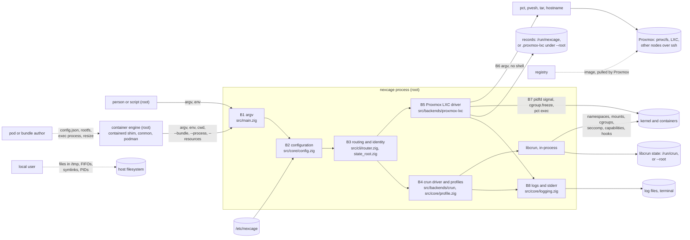

# ADR-003: Security architecture — the threat model of what ships

## Status

**Accepted 2026-10-13.** This supersedes the decision of 2024-12-01, which
described a defence-in-depth design for "Proxmox LXCRI": security profiles
with every capability dropped, runtime monitoring, image scanning, encrypted
audit logs, network policy and compliance frameworks. None of it was built,
and an operator who read it believed in controls that did not exist (F015 in
the [2026-10 hardening audit](../audits/2026-10-hardening-audit.md)). This
revision is [#320](https://github.com/CageForge/nexcage/issues/320): it
describes what nexcage is after that audit, and nothing else.

**How to read it.** Every statement points at the code that makes it true,
as `path:line` or a function in a named file, or at a test that fails when it
stops being true, and usually at both. A statement that nothing enforces says
so. Line numbers are those of this tree. `container.c:N` and `linux.c:N` are
lines of `deps/crun/src/libcrun/` at the pinned commit 7d6f6955, which is
crun 1.30.1 unchanged. Simulator checks are written `tests/sim/run.sh:<line>`,
the line the check is on. Nothing here is a compliance claim.

What a container is isolated by, mode by mode, is in
[ISOLATION.md](ISOLATION.md); this ADR is the rest of the model.

## Context

### What nexcage is

- **One binary, an OCI runtime.** It takes the command line runc and crun
  take (`create`, `start`, `kill`, `delete`, `exec`, `state`, ...), and has
  two backends ([BACKENDS.md](BACKENDS.md)): Proxmox LXC, which turns a
  command into `pct` and `pvesh` calls, and crun, which calls the vendored
  libcrun inside the nexcage process. A release binary has both, built
  ReleaseSafe and position-independent (`build.zig:252`; checked by
  `ci.yml`'s "The release build is position-independent", `.github/workflows/ci.yml:78-88`).
- **No daemon.** Every command is one process that exits when the command
  is done. nexcage's own code opens no network socket: there is no socket
  code in `src/`. Network calls are Proxmox's tools', and the Unix socket an
  engine names with `--console-socket` is handed to libcrun
  (`src/backends/crun/libcrun_driver.zig:103-109`).
- **Runs as root.** A container engine runs it as root, as its handler's
  binary (`deploy/kubernetes/node/containerd.toml:16`,
  `deploy/kubernetes/node/crio.conf:12`), and a person with sudo. nexcage
  does not check that it is root: `geteuid` is read only by tests and by
  the owner checks of the configuration file and the bundle archive's
  directory (`src/core/config.zig:540`, `src/backends/proxmox-lxc/oci.zig:193`).
  `pct` and the namespaces and cgroups libcrun makes need root, and a call
  refused for want of it ends in "permission denied; nexcage needs root on
  the Proxmox host" (`describeError`, `src/main.zig:335`). Under rootless
  podman it runs as the user, inside podman's user namespace
  (`src/core/config.zig:589-593`).
- **Two kinds of caller.** A person or a script drives the Proxmox LXC
  backend, and the crun backend at the command line. A container engine
  drives the crun backend only: it always passes `--pid-file`, and the Proxmox
  LXC backend refuses `--pid-file` and `--console-socket` on `create` and
  `run` (`src/cli/router.zig:213-241`; `tests/sim/run.sh:1443`, `:1446` for
  `create`; `run`'s refusal, `src/cli/router.zig:226-241`, has no check of
  its own; [ADR-006](ADR-006-LXC-Driven-By-An-Engine.md)).

### What nexcage does not do

It has no isolation of its own beyond what it asks of Proxmox and libcrun.
It does not scan or verify images, keep an audit log, monitor containers or
enforce network policy; nothing in `src/` does any of these.

## Assets

| Asset | Why it matters |
|---|---|
| The Proxmox VE host and its root account | nexcage runs as root there, and libcrun's C code parses bundles in that process |
| The cluster | `pvesh` reaches every node's containers and VMs; a call for another node is passed to that node over ssh |
| Other containers | A command has to act on the container it names and on no other, across reused VMIDs and shared names |
| The configuration file | It decides whether LXC containers are privileged, which profiles exist and what they require, and which file root appends its log to |
| nexcage's records and libcrun's state | Which backend an id is on, and what libcrun believes about a container (its stored config carries a profile's caps) |
| Template storage and bundle archives | Every container made from them runs their contents |
| The caller's environment | It can hold tokens and keys; `exec` must not hand it to a process in a container |
| Logs and the operator's terminal | Text from bundles, Proxmox users and tools is written there |
| Releases and CI | The binary and `.deb` users install; the self-hosted runners, where a job runs as root; repository secrets |

## Actors

| Actor | Controls | Trusted? |
|---|---|---|
| **Host administrator** (root) | The binary and its `nexcage@<profile>` links, `/etc/nexcage`, the engines' handler configuration, Proxmox's configuration, the environment and `PATH` nexcage runs with | Yes. Whatever root can do with nexcage it can do without it: `--mp /,mp=/host`, `--config`, `proxmox.unprivileged: false` are not defended against |
| **Container engine** (containerd's shim, conmon for CRI-O and podman) | nexcage's argv (`--root`, `--log`, `--systemd-cgroup`, `--pid-file`, `--bundle`, the id), its working directory and environment, the bundle directory, `--process` and `--resources` files | Yes, as root's agent. What it carries from a pod is not |
| **Pod or bundle author** | Everything in `config.json` that admission lets through, the rootfs, the command an `exec` runs, the values of an in-place resize; with podman or `ctr`, the id as well | No |
| **Image and registry** | A template's and an image's contents; the registry's answers to Proxmox's pull | No |
| **The workload** (processes in a container) | Its own rootfs and processes, what its init does with signals; its PID can exit and be reused | No |
| **Local unprivileged user** | Files in world-writable directories such as `/tmp` and `/var/tmp`, FIFOs and symlinks there, PIDs, a working directory root might run nexcage from | No |
| **Proxmox users with API rights** | Templates on a storage (`Datastore.AllocateTemplate`), snapshot descriptions (`VM.Snapshot`), the hostname of a container they may configure, VMIDs freed and taken | Partly: their text is escaped where nexcage prints it, and a container's identity is re-checked before nexcage acts on it |
| **CI contributors** | A pull request's code, workflows included; for a repository writer, workflows on branches and the repository's secrets | Fork authors no; writers within GitHub's limits; see [CI](#ci-and-the-self-hosted-runners) |

## Trust boundaries and data flows

| Boundary | What crosses it | Who controls it | Held at |
|---|---|---|---|
| B1 argv | Options, the id, exec's command, file names | Caller; a pod through the engine | `parseRuntimeOptions`, `findCommand`, `ownWordsEnd`, `src/main.zig:423-867` |
| B2 configuration | The file nexcage loads | Root, or whoever can write the file or its directory | `ConfigLoader.openTrusted`, `validate`, `src/core/config.zig:509-556`, `:837-935` |
| B3 routing and identity | Which backend and which container an id means | The id's chooser; Proxmox users who free and take VMIDs | `findBackend`, `src/cli/router.zig:443-455`; `PveClient.pick`, `confirm`, `src/backends/proxmox-lxc/pve.zig:580-706` |
| B4 bundle to libcrun | `config.json`, exec's process spec, update's resources | Pod author through the engine | `src/backends/crun/libcrun_driver.zig:195-306`, `:635-715`, `:850-926`; `src/core/profile.zig` |
| B5 bundle to Proxmox | `config.json`'s mounts and limits, the rootfs | Whoever wrote the bundle | `src/backends/proxmox-lxc/oci.zig`, `driver.zig:204-283` |
| B6 nexcage to Proxmox's tools | Argument vectors; the tools' output back | nexcage; Proxmox | `runBound`, `src/backends/proxmox-lxc/common.zig:115-217` |
| B7 nexcage to container processes | Signals, freezer writes, `pct exec` | nexcage; the workload owns the PIDs | `PveClient.kill`, `exec`, `freeze`, `src/backends/proxmox-lxc/pve.zig:1412-1443`, `:1661-1809` |
| B8 text out | Messages holding bundle, Proxmox and tool text | Anyone whose text is quoted | `escapeTo`, `Cell`, `src/core/logging.zig:149-195`; `quoted`, `src/core/json.zig` |

**What a container name or id can reach in an argument vector.** Every tool is
run without a shell, by name through `PATH`, with nexcage's environment
(`execvpe` in `runBound`, `src/backends/proxmox-lxc/common.zig:127-161`;
`std.process.Child` for `pct exec`, `src/backends/proxmox-lxc/pve.zig:1787`,
and for `health`'s checks, `src/core/integrity.zig:109-114`). Its stdin is
`/dev/null`, except for `pct exec`, which is given the caller's. On the Proxmox LXC backend a
name reaches `pct` only at `create`, as `--hostname <name>`, after it has been
checked as an RFC 1123 hostname, which cannot begin with `-`
(`src/backends/proxmox-lxc/driver.zig:111-114`, `:325-327`;
`src/core/validation.zig:25-57`). Every other command finds the container in
Proxmox's listings and passes Proxmox's VMID, all digits, and the node name
the listing gave (`locate`, `src/backends/proxmox-lxc/pve.zig:653-678`).
`kill` checks again that the VMID it puts into a cgroup path is digits
(`src/backends/proxmox-lxc/pve.zig:1733-1735`). Text that goes into a `pvesh`
path is held to Proxmox's own rule first, because `pvesh` hands the path of a
call for another node to that node's shell over ssh without quoting it
(`templateVolidStorage`, `src/backends/proxmox-lxc/pve.zig:2059-2075`):
`--node` (`src/main.zig:650-661`, `:1244-1251`), a snapshot name
(`checkSnapshotName`, `pve.zig:2082-2105`), a storage, a volid and a
`--filename` (`pve.zig:368-396`, `:2026-2075`). A registry reference is the
value of `--reference`, and a snapshot's description the value of
`--description`; Proxmox checks both. On the crun backend the id goes to
libcrun after `validateContainerId` (`src/core/validation.zig:8-22`), and
names a directory under libcrun's state root.

## What is validated, and where

| Input | From | Check | Code | Test |
|---|---|---|---|---|
| Any option | Caller | One no command takes, or a value option without its value, exits 2 naming it | `src/main.zig:724-738` | `tests/sim/run.sh:711`, `:714`, `:720` |
| `--flag=value` | Engine | Read as two words, except in the command `exec` runs | `splitEqualsFlags`, `restoreCommandWords`, `src/main.zig:159`, `:178`, `:759-776`, `:892-899` | `main.zig` test "a --flag=value is one word of nexcage's, whatever the flag"; `tests/sim/run.sh:455`, `:461` |
| The command `exec` runs | Caller; a pod | Never read as nexcage's options or logging flags, with `--` or without; an exec option written `--opt=value` that takes no value exits 2 | `ownWordsEnd`, `valueForNoValueOption`, `src/main.zig:168-180`, `:831-867`; `src/core/logging_config.zig:80` | `main.zig` tests "the command exec runs is the container's, flags, values and = included", "exec refuses a value for an option that takes none, rather than run it"; `logging_config.zig` test "logging flags after a bare -- belong to the command exec runs"; `tests/sim/run.sh:467`, `:472`, `:483`, `:513`, `:516` |
| `--config` | Caller | Must exist; replaces the search; then the file checks below | `src/main.zig:184-191` | `tests/sim/run.sh:743`, `:748` |
| `--root` | Engine | Absolute, normalised, so the default spelled otherwise is the default | `src/main.zig:195-206`; `state_root.set`, `src/core/state_root.zig:44-59` | `state_root.zig` test "a root that only looks different is still the default"; `tests/sim/run.sh:1222`, `:1238` |
| `--node` | Person | Proxmox's pve-node rule, before any `pvesh` call | `isNodeName`, `src/main.zig:650-661`, `:1244-1251` | `main.zig` test "--node takes what Proxmox's pve-node takes, and nothing that changes a path"; `tests/sim/run.sh:2215`-`:2223` |
| `--runtime` | Caller | `lxc`, `proxmox-lxc` or `crun`; anything else exits 2 | `src/main.zig:267-275`, `:542-549` | `tests/sim/run.sh:734`, `:736`, `:1331`, `:1347` |
| Profile name | Engine (argv[0]); person | Defined in the configuration; argv[0] and `--profile` agree; `--runtime` agrees | `src/main.zig:280-293`; `findProfile`, `src/cli/router.zig:158-180` | `tests/sim/run.sh:1368`, `:1371`, `:1373`, `:1375` |
| Configuration file | Root | Only `/etc/nexcage/config.json`, `/etc/nexcage/nexcage.json` or `--config`; owned by root or the caller and writable by nobody else, its directory likewise (sticky allowed), a symlink's target directory likewise; a directory or a FIFO with no writer is not waited on; at most 1 MiB; an OCI spec is passed over; an unknown key, a wrong type or a misspelt runtime refuses the file | `default_paths`, `src/core/config.zig:26-29`; `openTrusted`, `distrust`, `checkLinkTarget`, `:509-614`; `validate`, `:837-935` | `config.zig` tests "a config.json in the working directory is not read", "a configuration others can write, or replace in its directory, is refused", "only a file of root's or of the user running nexcage is trusted", "a symlink to a configuration is trusted only where the file it leads to is", "a FIFO where the configuration should be is not waited on"; `tests/sim/run.sh:269`, `:759`-`:798`, `:819`, `:1297`-`:1309` |
| Container name, Proxmox LXC `create` | Caller | An RFC 1123 hostname that no container in the cluster's listing has at `create` (a listing that fails refuses the create). Nothing holds the name until `pct create` has run: overlapping creates, or a create while the node of a container with the name is down, can give two containers one name, and every later command then refuses it ([ISOLATION.md](ISOLATION.md#proxmox-lxc-from-a-template-or-a-registry-image)) | `src/backends/proxmox-lxc/driver.zig:111-153`, `:116-126` | `validation.zig` test "a hostname is RFC 1123's: no label empty, longer than 63, or starting or ending in '-'"; `tests/sim/run.sh:121`-`:124`, `:313`, `:1917`, `:1962` |
| Container id, crun | Engine; caller | 1 to 64 of `[A-Za-z0-9_-]` on every driver entry | `validateContainerId`, `src/core/validation.zig:8-22`; `src/backends/crun/libcrun_driver.zig:202`, `:315`, `:352`, `:394`, `:478`, `:636`, `:781`, `:808`, `:853` | None of its own |
| An id, every command after `create` | Caller | Must have a record: libcrun's `status` file, or its kept `config.json` without a `state.json`, or nexcage's `state.json`; one path component. Otherwise it does not exist, and `delete --force` of it exits 0 and touches nothing. `--runtime lxc` reaches a Proxmox container without a record, and is refused for an id libcrun has | `findBackend`, `src/cli/router.zig:114-127`, `:443-455`; `crunHas`, `lxcHas`, `has`, `src/core/state_root.zig:92-111` | `router.zig` tests "an id with no backend's record is in neither backend", "under --root the Proxmox LXC records are in their own directory"; `state_root.zig` test "a create libcrun did not finish is libcrun's, and a directory with a state.json never is"; `tests/sim/run.sh:610`, `:613`, `:616`, `:622`, `:1805` |
| An id to a Proxmox container | Caller | A name before a VMID; a VMID only with `--runtime lxc`; a name two containers have, a miss while the cluster lists a container it gives no name, and an empty id are no answer | `pick`, `choose`, `src/backends/proxmox-lxc/pve.zig:569-639`; `src/cli/router.zig:206` | `pve.zig` tests "a name wins over a VMID, whichever the listing puts first", "a name two containers share is no answer", "by name alone, a VMID finds nothing", "a miss is no answer while a container has no name", "an empty id names no container, not one without a name"; `tests/sim/run.sh:1946`-`:1968`, `:2130`-`:2145`, `:2167`-`:2179` |
| The container found, when acted on | Proxmox (VMID reuse) | Its hostname is read again from its config right before nexcage starts, stops, destroys, signals, freezes or thaws it, runs a command in it, changes its limits or snapshots, or undoes a failed `create` or `run` | `confirm`, `confirmName`, `src/backends/proxmox-lxc/pve.zig:692-706`; callers in `src/backends/proxmox-lxc/driver.zig:516-523`, `:657-883` | `tests/sim/run.sh:1978`-`:2075`, `:2089`, `:2114`, `:692` |
| Signal | Caller | A name in any case or a number from 1 to 64; anything else exits 2. The number is what is sent | `src/core/signals.zig:57-73`; `src/backends/crun/libcrun_driver.zig:363-373` | `signals.zig` tests; `tests/sim/run.sh:418`-`:422`; `tests/crun/kill.sh` |
| Snapshot name, storage, volid, `--filename`, a pull's derived name | Person | Proxmox's own rules, before `pct` or `pvesh` | `pve.zig:368-396`, `:2026-2105` | `pve.zig` tests "snapshot names as Proxmox takes them, and not 'current'", "a template volid is <storage>:vztmpl/<file> and nothing more", "storage IDs as Proxmox parses them", "a --filename is one Proxmox leaves as it is"; `tests/sim/run.sh:1710`, `:1863`, `:1866`, `:2356`, `:2400`, `:2460`, `:2471` |
| `create`'s pct options | Person | `--ip` and `--gw` without `,` or `=`, which would add a `net0` key; `--vlan` 1 to 4094; limits converted exactly or refused | `src/cli/create.zig:127-150`; `resourceOptions`, `src/backends/proxmox-lxc/pve.zig:1491-1577` | `tests/sim/run.sh:297`-`:309` |
| Bundle path | Engine | Absolute and resolved; no list of allowed places | `validateBundlePath`, `src/core/validation.zig:83-89` | `tests/sim/run.sh:859`, `:862` |
| Bundle, crun | Pod author | At most 16 MiB; read once, and libcrun is given those bytes; a JSON object, with duplicate keys, a NUL in a key or a string, and nesting past 64 levels refused; no `io.cageforge.nexcage.profile*` annotation; memory values libcrun can do arithmetic on; the profile's checks | `src/backends/crun/libcrun_driver.zig:231-274`; `parse`, `checkDocument`, `refuseClaim`, `src/core/profile.zig:418-486`; `checkMemory`, `libcrun_driver.zig:728-748` | [ISOLATION.md](ISOLATION.md#crun-with-the-engines-bundle-as-it-is) |
| Bundle, Proxmox LXC | Bundle author | At most 10 MiB. A value of the wrong type is refused in `mounts` and each mount's fields, in `linux`, `linux.resources` with its `memory` and `cpu`, `memoryPolicy`, `intelRdt` and `netDevices`, and in the entries of `process.args` and `process.env`; it is passed over, with no error, in `root`, `process`, `hostname`, `args` or `env` as a whole, `linux.seccomp` and `linux.namespaces`, none of which the backend applies. Mounts, options and limits checked | `deps/oci-spec-zig/src/runtime/bundle.zig:94`; refused `:207-237`, `:240-466`, `:632-644`; passed over `:162-200`, `:473-516`; `src/backends/proxmox-lxc/oci.zig:267-446` | [ISOLATION.md](ISOLATION.md#proxmox-lxc-from-an-oci-bundle) |
| `exec --process` file, crun | Pod, through the engine | Under a profile: parsed as above and cut to the container's bounding set. Otherwise passed to libcrun by path | `src/backends/crun/libcrun_driver.zig:861-926` | `tests/crun/profile.sh` |
| `update` document | Engine | At most 1 MiB; a JSON object read as libcrun reads it; memory values; a profile's recorded caps; handed over NUL-terminated (crun). On Proxmox LXC a setting Proxmox has no option for is refused by name | `src/cli/update.zig:126-132`; `src/backends/crun/libcrun_driver.zig:635-691`; `src/backends/proxmox-lxc/driver.zig:775-792` | `tests/crun/profile_update.sh`, `tests/crun/update.sh`; `tests/sim/run.sh:1647`-`:1668` |
| Tools' output | Proxmox | Read up to 1 MiB, the cluster listing up to 64 MiB; more is an error, never a short answer; a listing that fails is an error, never an empty cluster or this host alone | `runCommandMax`, `src/backends/proxmox-lxc/common.zig:13-55`; `clusterResources`, `list`, `pve.zig:759`, `:1187` | `common.zig` tests "output past the cap is an error, not a short answer", "the cluster's listing is read whole: 2 MiB is within its cap"; `tests/sim/run.sh:1894`, `:1911`, `:1914`, `:1924`, `:1929` |
| Text nexcage did not write, on its way to a log, stderr or a table | Bundles, Proxmox users, tools | In a text log line, on stderr and in a table: C0 and C1 controls, DEL, U+2028, U+2029 and bytes that are not UTF-8 escaped, backslashes doubled, and a table cell's tab escaped. In a JSON log line: the same controls as `\u` escapes, a byte that is not UTF-8 left as it is | `escapeTo`, `Cell`, `src/core/logging.zig:149-195`; `quoted`, `writeStringContents`, `src/core/json.zig` | `logging.zig` tests "a logged value cannot add a line or a terminal escape", "a table cell of someone else's text is one cell of one row, and sends the terminal nothing"; `json.zig` test; `tests/sim/run.sh:152`, `:346`, `:1777`, `:2293`, `:1002` |

## What nexcage refuses

Beyond malformed input, these refusals are decisions; each is a row above or
in [ISOLATION.md](ISOLATION.md):

- **A configuration it cannot trust**, and any `./config.json`: root reads
  `/etc/nexcage` or `--config` and nothing else.
- **Engine-driven Proxmox LXC**: `--pid-file` and `--console-socket` on
  `create` and `run`, and on `exec` `--process`, `--detach`, `--user`,
  `--cwd`, `--console-socket`, `--pid-file`, and `--tty` without a terminal,
  rather than run the command as someone else or without what was asked
  (`src/cli/router.zig:213-241`, `:277-303`; `tests/sim/run.sh:533`-`:549`).
- **An id no backend has a record of**, a name that is not one container,
  and a container that was replaced after it was found.
- **A bundle libcrun would read otherwise than nexcage checked it**, and one
  that claims a profile.
- **A bundle mount the Proxmox LXC backend cannot apply as asked.**
- **Names that would change a `pvesh` path.**
- **Memory values libcrun's arithmetic would overflow on**, where a UBSan
  trap would stop the process half way (`build.zig:154-162`).
- **A `$TMPDIR` another user could swap a directory in**, before a bundle is
  packed (`archiveBase`, `src/backends/proxmox-lxc/oci.zig:173-199`;
  `tests/sim/run.sh:914`, `:931`).
- **A log path whose last component is a symlink, and a FIFO nobody reads**
  (`openAppend`, `src/core/logging.zig:49-56`; `logging.zig` tests "a log
  path whose last component is a symlink is not followed", "a FIFO in a log
  file's place is not waited on, and one that is read is written as a file
  is"; `tests/sim/run.sh:1419`, `:1426`, `:1434`).
- **Under a profile**, what [ADR-005](ADR-005-Isolation-Profiles.md) and
  [ISOLATION.md](ISOLATION.md#crun-under-an-isolation-profile) list.

An error outside the set a command declares is reported as a failure naming
it, not a panic (`narrow`, `src/cli/registry.zig:114-130`; `registry.zig` test
"a command error outside core.types.Error is an error exit naming it, not a
panic"; `tests/sim/run.sh:98`).

## State and its protection

| State | Where | Written how | What relies on it | Code; test |
|---|---|---|---|---|
| nexcage's record of a Proxmox LXC container | `/run/nexcage/<name>/state.json` and `runtime-metadata.json`; under `--root <dir>`, `<dir>/.proxmox-lxc/<name>/`, out of libcrun's way | By root, written to a new file (`O_EXCL\|O_NOFOLLOW`, synced) and renamed over the old one; the directories and files with the default modes, 0755 and 0644 under a umask of 022. Written at `create` right after `pct create`, and by `start`, `stop`, `pause`, `resume` and `rollback`; removed at `delete` and by an undone `create`. The name is one path component, never `.` or `..` | Which backend an id is on; "created" against "stopped"; `state`'s `bundle`. Not the VMID or the status, which are read from Proxmox each time: a record proves a name, not a VMID | `writeOciState`, `src/backends/proxmox-lxc/driver.zig:981-1000`; `writeFileAtomic`, `src/backends/proxmox-lxc/common.zig:229-252`; `forget`, `recordAs`, `driver.zig:908-945`; `src/core/state_root.zig:21-37`, `:44-59`. `common.zig` test "writeFileAtomic: a reader keeps a whole file, and a failed write keeps the old one"; `tests/sim/run.sh:115`, `:1198`, `:1210`, `:1216`, `:1225` |
| libcrun's state | `/run/crun/<id>`, or `<dir>/<id>` under `--root` | By libcrun, 0700. nexcage reads whether `status` or `config.json` is there to route, and reads the kept `config.json` for a profile's caps and bounding set | Routing; `update` and `exec` under a profile | `crunHas`, `src/core/state_root.zig:67-95`; `holdToProfile`, `boundProcessFile`, `src/backends/crun/libcrun_driver.zig:697-715`, `:901-926`. `tests/crun/exec_spec.sh` (mode 700), `tests/crun/lxc_root.sh` |
| `exec`'s process spec | In the container's libcrun state directory | A new 0600 file with a random name, `O_EXCL\|O_NOFOLLOW`; removed after the exec. One a killed exec leaves goes with the container | That libcrun reads what nexcage wrote | `writeSpecFile`, `src/backends/crun/libcrun_driver.zig:952-997`. `libcrun_driver.zig` test "exec's process spec is a new 0600 file in the container's own state directory"; `tests/crun/exec_spec.sh` |
| A bundle's packed rootfs | `$TMPDIR` or `/var/tmp`, in `nexcage-bundle-<name>-<random>/rootfs.tar.zst` | 0600 in a new 0700 directory, under a base only root or nexcage's user owns and that is sticky if others can write it; removed after `pct create`, on failure, and on SIGINT, SIGTERM and SIGHUP, one handler for the three (`src/backends/proxmox-lxc/oci.zig:51-52`), of which the simulator sends SIGTERM. SIGKILL leaves it, readable by root only | Nothing after `pct create` | `src/backends/proxmox-lxc/oci.zig:47-233`. `tests/sim/run.sh:886`-`:967` |
| Logs | `--log`, `--log-file`, `NEXCAGE_LOG_FILE`, `log_file` in the configuration | Appended (`O_APPEND\|O_CREAT\|O_NOFOLLOW\|O_CLOEXEC`), mode 0640 when created; text escaped; the command `exec` runs is counted, never written | An engine reads `--log` for the reason a call failed | `openAppend`, `src/core/logging.zig:49-56`; `src/main.zig:229-234`. `logging.zig` test "two writers to one log file keep each other's lines"; `tests/sim/run.sh:501`, `:506`, `:1413` |
| The configuration | `/etc/nexcage/config.json`, `/etc/nexcage/nexcage.json`, or `--config` | Root's; nexcage never writes it, and refuses one others could have written | Everything in [B2](#trust-boundaries-and-data-flows) | The configuration row [above](#what-is-validated-and-where) |
| A container's Proxmox configuration | `/etc/pve/lxc/<vmid>.conf` | Through `pct` and `pvesh` only; nexcage writes no file under `/etc/pve` | Proxmox | `applyMountPoints`, `src/backends/proxmox-lxc/oci.zig:459-486`. `tests/sim/run.sh:1039` |
| Pulled templates | A Proxmox storage, as `<storage>:vztmpl/<name>.tar` | By Proxmox's pull, under the name nexcage derives from the whole reference | Every container made from it; only that exact name is used | `pulledTemplateName`, `src/backends/proxmox-lxc/pve.zig:1991-2013`. `pve.zig` test "a pulled template is named for the whole reference, and two references never share a name" |

`/run` is emptied at boot, and with it every record: a Proxmox container made
before the boot is then reached with `--runtime lxc`, and a command that
changes it writes its record again (`recordAs`,
`src/backends/proxmox-lxc/driver.zig:928-945`; `tests/sim/run.sh:1750`). A
record's directory is protected by its parent's owner, which is root's for
`/run/nexcage` and the engine's for `--root`.

## CI and the self-hosted runners

What runs where is in [CI_CD_SETUP.md](../CI_CD_SETUP.md); what matters to
this model:

- **Three jobs run on self-hosted machines** where the runner user has sudo
  for everything: `proxmox_e2e.yml` and `k8s_e2e.yml`'s node job on
  `[self-hosted, pve9]`, and `buildagent.yml` on
  `[self-hosted, buildagent, nexcage]` (`.github/workflows/proxmox_e2e.yml:69-70`,
  `.github/workflows/k8s_e2e.yml:81-82`, `.github/workflows/buildagent.yml:44-45`).
  The runners are persistent: what one job leaves, the next finds
  ([CI_CD_SETUP.md](../CI_CD_SETUP.md#self-hosted-runners-and-forks)).
- **The `if:` on those jobs is not a boundary.** A pull request runs its own
  copy of the workflows, and a fork can delete the line or add a workflow of
  its own ([CI_CD_SETUP.md](../CI_CD_SETUP.md#self-hosted-runners-and-forks)).
- **What keeps a fork's code off them is GitHub's settings.** The fork-PR
  approval policy is `all_external_contributors` since 2026-10-11, so every
  outside contributor's run waits for a maintainer, and approving it is
  approving that code as root on those machines. Runners only named
  workflows at `refs/heads/main` can use, or a private repository for the
  E2E, are still to be set up, with the other steps the audit left to the
  maintainer ([audit](../audits/2026-10-hardening-audit.md#the-maintainers-remaining-steps)).
  `scripts/check_runner_exposure.sh` reads the settings and fails until they
  are done; its own test feeds it the settings of 2026-10-11 and sees it fail
  (`tests/scripts/check_runner_exposure.sh`).
- **GitHub-hosted workflows** hold a read-only token unless a job asks for
  more (every workflow's top-level `permissions:`); third-party actions are
  pinned to a commit and GitHub's own to a tag, which zizmor enforces
  (`.github/zizmor.yml`, `security.yml`'s `zizmor` job); `security.yml`'s
  scanners fail on what they find, and none of them reads Zig or libcrun's C.
- **A release** builds its binary with a Zig whose sha256 is checked
  (`Dockerfile:42-56`), crun at the commit `deps/crun` pins
  (`Dockerfile:65-75`, held to the submodule by `scripts/ci/check_crun_pin.sh`)
  and crun's release tarball, for its generated headers, checked against a
  pinned sha256 (`scripts/gen_crun_headers_local.sh:11-63`); it attests the binary and the `.deb`
  where they are built (`.github/workflows/release.yml:84-101`, `:158`, `:316`).
  `gh attestation verify` checks a download ([INSTALL.md](../INSTALL.md#from-a-release)).
  `provenance.json` is a statement the workflow writes about itself, unsigned
  (`.github/workflows/release.yml:168-199`), and the CycloneDX SBOM lists no
  components (`:232-251`): [#318](https://github.com/CageForge/nexcage/issues/318),
  [#333](https://github.com/CageForge/nexcage/issues/333).

## Security assumptions

What the model above takes as given. When one does not hold, the guarantee
that rests on it does not either.

1. **Whoever runs nexcage is root, or root's agent.** Its options, its
   environment and its `PATH`, which finds every tool
   (`src/backends/proxmox-lxc/common.zig:129`, `:161`), are not defended
   against. The environment reaches those tools, and libcrun reads
   `RUN_OCI_SECCOMP_RECEIVER` from it (`container.c:2215`).
2. **`/etc/nexcage` and the directories above a configuration file are
   root's.** The file and its own directory are checked; the directories
   above them are not (`src/core/config.zig:558-565`).
3. **`/run` is root's, and an engine's `--root` is writable by the engine
   alone.** nexcage does not check the owner of a state directory.
4. **Proxmox VE and its tools are trusted**: `pct`, `pvesh`, `pvesm`,
   pmxcfs, the other nodes of the cluster, and the confinement pve-container
   gives a container. Their output is parsed, capped and escaped, not doubted.
5. **The kernel has cgroup v2 and `pidfd_open`** (Linux 5.3), which the
   Proxmox LXC `kill` needs and refuses without
   (`src/backends/proxmox-lxc/pve.zig:1687-1702`); and user namespaces where a
   profile requires one.
6. **libcrun 1.30.1 is trusted to do what the bundle says.** Its C code
   parses the bundle in the root process; the binary is a PIE and libcrun is
   compiled with UBSan traps (`build.zig:154-162`, `:252`), which stop the
   kinds of undefined behaviour UBSan checks, not memory errors, and the
   structures nexcage shares with it are compared with its header at build
   time (`src/backends/crun/mod.zig:17-40`).
7. **An engine builds the bundle from what admission allowed**, passes
   argv[0] as its handler names it, and lets no `run.oci.*` annotation
   through from a pod (no annotation allowlist on the shipped handlers,
   `deploy/kubernetes/node/`).
8. **Pod Security Admission, `RuntimeClass` policy and who may run podman
   as root are the cluster's and the host's**, not nexcage's
   ([ISOLATION.md](ISOLATION.md)).

## What this does not cover

- **Anything not in the code.** Earlier text promised seccomp defaults,
  capability drops, image signature checks, monitoring and compliance
  controls. They are not there, and this ADR claims none.
- **Residual risks the audit left open**, each with its owner, are in the
  [audit report](../audits/2026-10-hardening-audit.md#residual-risks-and-open-items).
- **Nothing in CI checks these references.** They were checked against this
  tree when this was written; a change that moves a check should move its
  row here.

## Consequences

- A security claim about nexcage is one this ADR or ISOLATION.md makes and
  points at; anything else is not one.
- A change that adds an input, a refusal, a privileged operation or a piece
  of state adds its row here, with the code and the test.
- The model is one of a root tool: most of what an operator decides
  (privileged containers, host mounts, which pods may use which profile) is
  theirs, and is said to be.

## Links

- [ISOLATION.md](ISOLATION.md) — what each execution mode isolates
- [ADR-005](ADR-005-Isolation-Profiles.md) — isolation profiles;
  [ADR-006](ADR-006-LXC-Driven-By-An-Engine.md) — why an engine does not
  drive the Proxmox LXC backend
- [BACKENDS.md](BACKENDS.md) — what each backend runs
- [The 2026-10 hardening audit](../audits/2026-10-hardening-audit.md) — the
  findings this model was rewritten from, and what is still open
- [#320](https://github.com/CageForge/nexcage/issues/320),
  [#321](https://github.com/CageForge/nexcage/issues/321),
  [#318](https://github.com/CageForge/nexcage/issues/318)
- [SECURITY.md](https://github.com/CageForge/nexcage/blob/main/SECURITY.md) — reporting a vulnerability
