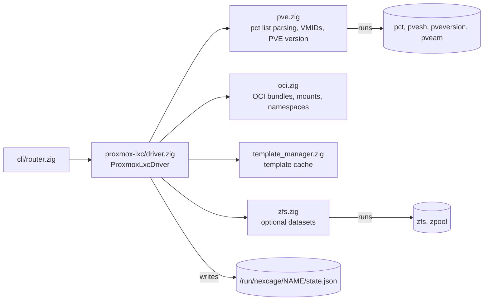

# Backends

`src/backends/mod.zig` always imports the Proxmox LXC backend, and the crun
backend only when its build option (declared in `build.zig`) is on.
The CLI router (`src/cli/router.zig`) sends a command to a backend according
to the routing rules in the config file; without rules everything goes to
Proxmox LXC.

| Backend | Build option | Default | State |
|---|---|---|---|
| Proxmox LXC | — | always | Supported; exercised by the Proxmox E2E job |
| crun | `-Denable-backend-crun` | off in `zig build`; on in every release binary since 0.17.0 | Supported for the OCI runtime-spec command line; links vendored libcrun from `deps/crun`. Verified with podman, `ctr`, containerd's CRI, CRI-O and a kubelet. A release's one binary and its `.deb` carry it next to Proxmox LXC (#380) |

A command routed to a backend that is compiled out fails with
`UnsupportedOperation`.

## Proxmox LXC

| Operation | What the driver runs |
|---|---|
| create | `pvesh get /cluster/nextid`, then `pct create <vmid> <template> --hostname <name> ...`. On Proxmox VE 9.1+ a registry image not already on the storage is pulled first with `pvesh create .../oci-registry-pull`. With `--node` naming another node: only a `<storage>:vztmpl/<file>` template is accepted, `pvesh get /nodes/<node>/storage/<storage>/content --content vztmpl` checks that node has it, then `pvesh create /nodes/<node>/lxc --vmid <vmid> --ostemplate <template> --hostname <name> ...` |
| start | `pct start <vmid>`; on another node `pvesh create /nodes/<node>/lxc/<vmid>/status/start` |
| stop | `pct shutdown <vmid> --timeout 60 --forceStop 1`; on another node `pvesh create /nodes/<node>/lxc/<vmid>/status/shutdown --timeout 60 --forceStop 1` |
| delete | `pct destroy <vmid>`; on another node `pvesh delete /nodes/<node>/lxc/<vmid>`. With `--force`, a running container is stopped first |
| kill | `kill(2)` to the container's init from the host, with the PID from `pct status --verbose` — `pct exec` cannot deliver SIGKILL to a namespace's init; refused for a container on another node |
| exec | `pct exec <vmid> -- <argv>`, stdio inherited; refused for a container on another node, and with `--process` or `--detach` |
| pause, resume | writes `1` / `0` to `/sys/fs/cgroup/lxc/<vmid>/cgroup.freeze` (not `pct suspend`); refused for a container on another node |
| update | `pct set <vmid>` with `--memory`/`--swap`/`--cpulimit`/`--cpuunits`; on another node `pvesh set /nodes/<node>/lxc/<vmid>/config` with the same options |
| snapshot | `pct snapshot <vmid> <name> [--description ...]`; on another node `pvesh create /nodes/<node>/lxc/<vmid>/snapshot --snapname <name> [--description ...]` |
| rollback | `pct rollback <vmid> <name> [--start 1]`; on another node `pvesh create /nodes/<node>/lxc/<vmid>/snapshot/<name>/rollback [--start 1]` |
| delsnapshot | `pct delsnapshot <vmid> <name>`; on another node `pvesh delete /nodes/<node>/lxc/<vmid>/snapshot/<name>` |
| snapshots | `pvesh get /nodes/<node>/lxc/<vmid>/snapshot`, for a container here as well as elsewhere |
| pull, images, rmi | `pvesh create /nodes/<node>/storage/<storage>/oci-registry-pull --reference <ref>`; `pvesh get /nodes/<node>/storage/<storage>/content --content vztmpl` per template storage; `pvesh delete /nodes/<node>/storage/<storage>/content/<volid>` |
| list, name to VMID | `pvesh get /cluster/resources --type vm` for every node, merged with `pct list` for this one (the cluster view is a cache) |

### A container from an OCI bundle

`create` from a bundle makes a system container of the bundle's `rootfs/`:
the rootfs is packed into an archive for `pct create`, which takes nothing
else from `config.json`. The archive is 0600, in a directory only root can
enter under `$TMPDIR` or `/var/tmp`, outside every Proxmox storage, and is
deleted once pct create has read it. What the backend then takes from the bundle
is listed in the [CLI reference](../CLI_REFERENCE.md#create); the rest of
this section is what that means for the container's confinement.

**Mounts.** Each bind mount becomes a Proxmox mount point, given with
`pct set <vmid> --mpN <source>,mp=<destination>` once the container exists.
At every start Proxmox bind-mounts the source directory, as root on the host,
into the container. Any host directory can be named: like runc and crun,
nexcage has no list of host paths a bundle may not mount, so whoever writes
the bundle chooses what of the host the container sees, as `--mp` lets
whoever runs nexcage choose. What the container can do there is the user
namespace's to decide. In an unprivileged container (the default) container
root is uid 100000 on the host, so through the mount it has the access any
other unprivileged user has: it reads what is world-readable and writes
nothing root owns, while files owned by the mapped uids are its own. In a
privileged container (`proxmox.unprivileged: false`) container
root is host root on whatever the mount shows. Read a bundle's mounts before
creating a container from it.

**Features.** A bundle turns on no Proxmox features. Its namespaces are
LXC's to make, and a user namespace in the bundle used to set `nesting=1`
and `keyctl=1`, loosening the container's AppArmor profile and lifting the
keyctl filter Proxmox puts on an unprivileged container.

**Confinement.** The container is confined the way Proxmox confines every
container: its AppArmor profile, LXC's capability drops and seccomp filter,
its device rules, and the user namespace of an unprivileged container. A
bundle's own `process.capabilities`, `linux.seccomp`, AppArmor profile,
`noNewPrivileges`, read-only or masked paths and devices are not applied, so
a bundle cannot loosen that confinement, and cannot tighten it either. create
says which of them a bundle sets, in one warning, rather than refusing,
since `runc spec` puts capabilities, masked paths and `noNewPrivileges` into
every bundle. The crun backend applies them.
