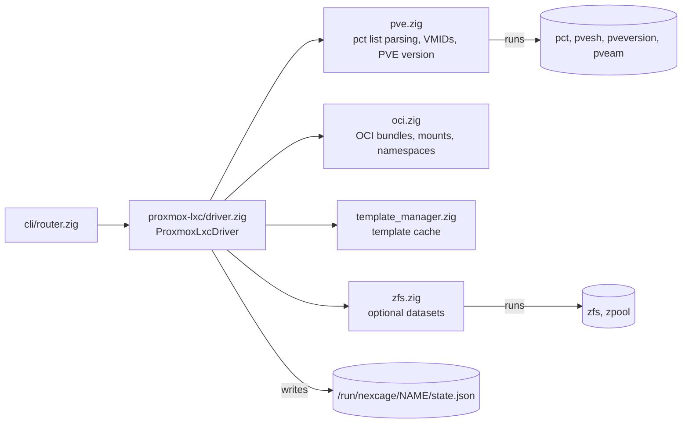

# Backends

`src/backends/mod.zig` always imports the Proxmox LXC backend, and the crun
backend only when its build option (declared in `build.zig`) is on.
The CLI router (`src/cli/router.zig`) sends a command to a backend according
to the routing rules in the config file; without rules everything goes to
Proxmox LXC.

| Backend | Build option | Default | State |
|---|---|---|---|
| Proxmox LXC | — | always | Supported; exercised by the Proxmox E2E job |
| crun | `-Denable-backend-crun` | off in `zig build`; on in every release binary since 0.17.0 | Supported for the OCI runtime-spec command line; links vendored libcrun from `deps/crun`. Verified with podman, `ctr`, containerd's CRI, CRI-O and a kubelet. A release's one binary and its `.deb` carry it next to Proxmox LXC (#380) |

A command routed to a backend that is compiled out fails with
`UnsupportedOperation`.

## Proxmox LXC

| Operation | What the driver runs |
|---|---|
| create | `pvesh get /cluster/nextid`, then `pct create <vmid> <template> --hostname <name> ...`. On Proxmox VE 9.1+ a registry image not already on the storage is pulled first with `pvesh create .../oci-registry-pull`. With `--node` naming another node: only a `<storage>:vztmpl/<file>` template is accepted, `pvesh get /nodes/<node>/storage/<storage>/content --content vztmpl` checks that node has it, then `pvesh create /nodes/<node>/lxc --vmid <vmid> --ostemplate <template> --hostname <name> ...` |
| start | `pct start <vmid>`; on another node `pvesh create /nodes/<node>/lxc/<vmid>/status/start` |
| stop | `pct shutdown <vmid> --timeout 60 --forceStop 1`; on another node `pvesh create /nodes/<node>/lxc/<vmid>/status/shutdown --timeout 60 --forceStop 1` |
| delete | `pct destroy <vmid>`; on another node `pvesh delete /nodes/<node>/lxc/<vmid>`. With `--force`, a running container is stopped first |
| kill | `kill(2)` to the container's init from the host, with the PID from `pct status --verbose` — `pct exec` cannot deliver SIGKILL to a namespace's init; refused for a container on another node |
| exec | `pct exec <vmid> -- <argv>`, stdio inherited; refused for a container on another node, and with `--process` or `--detach` |
| pause, resume | writes `1` / `0` to `/sys/fs/cgroup/lxc/<vmid>/cgroup.freeze` (not `pct suspend`); refused for a container on another node |
| update | `pct set <vmid>` with `--memory`/`--swap`/`--cpulimit`/`--cpuunits`; on another node `pvesh set /nodes/<node>/lxc/<vmid>/config` with the same options |
| snapshot | `pct snapshot <vmid> <name> [--description ...]`; on another node `pvesh create /nodes/<node>/lxc/<vmid>/snapshot --snapname <name> [--description ...]` |
| rollback | `pct rollback <vmid> <name> [--start 1]`; on another node `pvesh create /nodes/<node>/lxc/<vmid>/snapshot/<name>/rollback [--start 1]` |
| delsnapshot | `pct delsnapshot <vmid> <name>`; on another node `pvesh delete /nodes/<node>/lxc/<vmid>/snapshot/<name>` |
| snapshots | `pvesh get /nodes/<node>/lxc/<vmid>/snapshot`, for a container here as well as elsewhere |
| pull, images, rmi | `pvesh create /nodes/<node>/storage/<storage>/oci-registry-pull --reference <ref>`; `pvesh get /nodes/<node>/storage/<storage>/content --content vztmpl` per template storage; `pvesh delete /nodes/<node>/storage/<storage>/content/<volid>` |
| list, name to VMID | `pvesh get /cluster/resources --type vm` for every node, merged with `pct list` for this one (the cluster view is a cache) |

## crun

The crun backend calls libcrun in the nexcage process, linked from the
vendored `deps/crun`; `src/backends/crun/libcrun_driver.zig` is the driver and
`libcrun_ffi.zig` the hand-written binding, whose structs the build compares
with the vendored header field by field. What nexcage does around libcrun:

- **libcrun is compiled with UBSan in trap mode**, which is what ReleaseSafe
  does to C, and kept so on purpose: undefined behaviour in libcrun stops the
  process rather than carrying on with a value nobody chose. A `SIGILL` whose
  frames are in libcrun is such a trap, not a CPU without AVX2. Memory values
  that are known to reach libcrun's int64 arithmetic are refused first, on
  `create` and on `update`: a limit, swap or reservation is `-1` or a number of
  bytes, and a swap minus limit that does not fit in 64 bits is refused too.
- **`create` gives libcrun the spec it checked**, as bytes, never the
  bundle's `config.json` to read for itself: libcrun read a file twice, to
  parse it and to keep a copy in its state directory, and a bundle changed
  after nexcage's checks, or between the two reads, went to libcrun
  unchecked.
- **A document with a NUL in a key or a string, or nested deeper than 64
  levels, is refused**: the bundle's spec on `create` and the resources
  document on `update`, with or without a profile, and `exec`'s process spec
  under one. libcrun's parser ends a key or a string at a NUL and keeps the
  last of two keys that are then the same, so `"limit\u0000"` after
  `"limit"` was the limit libcrun applied, while nexcage's checks read the
  first. No runtime spec has a NUL anywhere, or nests past 64 levels.
- **`create` and `exec` run from a sealed copy of the binary** (the
  CVE-2019-5736 protection): the driver calls libcrun's
  `ensure_cloned_binary` before anything else. libcrun does that from a
  constructor in `linux.c`, before `main`, on every run of the binary;
  `build.zig` compiles that one file with the constructor defined away, so
  `version`, `--help` and Proxmox LXC commands no longer need `/proc`,
  `open_tree` or an executable memfd. The requirements are in
  [INSTALL.md](../INSTALL.md#for-a-container-engine).
- **`delete --force` removes the cgroup an unfinished `create` left**: the
  default `/sys/fs/cgroup/<id>`, when libcrun's state for the id has no status
  file and `delete` was not given `--systemd-cgroup`, and with `rmdir` alone
  (see `delete` in the [CLI reference](../CLI_REFERENCE.md#delete)).
