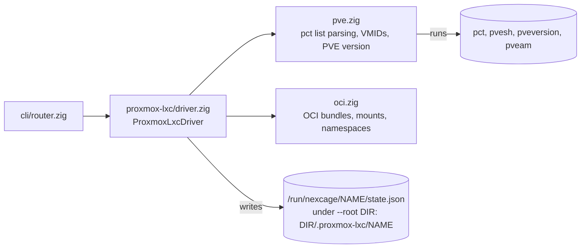

# Backends

`src/backends/mod.zig` always imports the Proxmox LXC backend, and the crun
backend only when its build option (declared in `build.zig`) is on.
The CLI router (`src/cli/router.zig`) sends `create` and `run` to a backend
according to the routing rules in the config file, Proxmox LXC without rules.
Every other command goes to the backend that has a record of the container —
libcrun's `status` file, or the `state.json` nexcage writes for a Proxmox LXC
container — and an id neither has a record of does not exist. `--runtime`
overrides the rules for `create` and `run`, and for any other command names
the backend of a container without a record: a Proxmox container nexcage did
not create, one named by its VMID, or one whose record a reboot cleared from
`/run`. A command that changes such a container (start, stop, pause, resume,
rollback) writes its record again. `--runtime lxc` is refused for an id
libcrun has a record of. See
[CLI_REFERENCE.md](../CLI_REFERENCE.md#backend-selection).

| Backend | Build option | Default | State |
|---|---|---|---|
| Proxmox LXC | — | always | Supported; exercised by the Proxmox E2E job |
| crun | `-Denable-backend-crun` | off in `zig build`; on in every release binary since 0.17.0 | Supported for the OCI runtime-spec command line; links vendored libcrun from `deps/crun`. Verified with podman, `ctr`, containerd's CRI, CRI-O and a kubelet. A release's one binary and its `.deb` carry it next to Proxmox LXC (#380) |

A command routed to a backend that is compiled out fails with
`UnsupportedOperation`.

## Proxmox LXC

| Operation | What the driver runs |
|---|---|
| create | `pvesh get /cluster/nextid`, then `pct create <vmid> <template> --hostname <name> ...`. On Proxmox VE 9.1+ a registry image is pulled first with `pvesh create .../oci-registry-pull --filename <name>`, the name derived from the whole reference, unless the storage already holds exactly that file; no other template is taken for it. With `--node` naming another node: only a `<storage>:vztmpl/<file>` template is accepted, `pvesh get /nodes/<node>/storage/<storage>/content --content vztmpl` checks that node has it, then `pvesh create /nodes/<node>/lxc --vmid <vmid> --ostemplate <template> --hostname <name> ...`. The `state.json` record is written as soon as that has succeeded; a create that fails afterwards destroys the CT and the record, and keeps the record only if that destroy fails, so that `delete --force <name>` removes the CT |
| start | `pct start <vmid>`; on another node `pvesh create /nodes/<node>/lxc/<vmid>/status/start` |
| stop | `pct config <vmid>` to check the hostname is still the name resolved, then `pct shutdown <vmid> --timeout 60 --forceStop 1`; on another node `pvesh get /nodes/<node>/lxc/<vmid>/config`, then `pvesh create /nodes/<node>/lxc/<vmid>/status/shutdown --timeout 60 --forceStop 1` |
| delete | the same hostname check, then `pct destroy <vmid>`; on another node `pvesh delete /nodes/<node>/lxc/<vmid>`. With `--force`, a running container is stopped first, and the check is made again before the destroy. `--force` of a container nexcage has a record of and no node has any more removes the record and runs nothing, unless the cluster lists a container it has no name for, which may be that one: then it exits 1 and keeps the record |
| kill | the same hostname check, then a signal to the container's init from the host, with the PID from `pct status --verbose`: a pidfd is opened for it, the PID must be in a `cgroup.procs` under `/sys/fs/cgroup/lxc/<vmid>/` (one that cannot be read, such as a threaded cgroup's, is passed over), and `pidfd_send_signal` sends it, so a PID reused since `pct status` read it is never signalled — `pct exec` cannot deliver SIGKILL to a namespace's init; refused for a container on another node |
| exec | `pct exec <vmid> --keep-env 0 -- <argv>`, stdio inherited: the command gets LXC's clean environment, not the caller's; refused for a container on another node, and with `--process` or `--detach` |
| pause, resume | writes `1` / `0` to `/sys/fs/cgroup/lxc/<vmid>/cgroup.freeze` (not `pct suspend`); refused for a container on another node |
| update | `pct set <vmid>` with `--memory`/`--swap`/`--cpulimit`/`--cpuunits`; on another node `pvesh set /nodes/<node>/lxc/<vmid>/config` with the same options. Any other setting, in flags or a `--resources` document, and a value pct cannot say as asked (a quota under a hundredth of a core, memory under 16 MiB), is refused by name before pct is asked |
| snapshot | `pct snapshot <vmid> <name> [--description ...]`; on another node `pvesh create /nodes/<node>/lxc/<vmid>/snapshot --snapname <name> [--description ...]` |
| rollback | the same hostname check, then `pct rollback <vmid> <name> [--start 1]`; on another node `pvesh create /nodes/<node>/lxc/<vmid>/snapshot/<name>/rollback [--start 1]` |
| delsnapshot | `pct delsnapshot <vmid> <name>`; on another node `pvesh delete /nodes/<node>/lxc/<vmid>/snapshot/<name>` |
| snapshots | `pvesh get /nodes/<node>/lxc/<vmid>/snapshot`, for a container here as well as elsewhere |
| pull, images, rmi | `pvesh create /nodes/<node>/storage/<storage>/oci-registry-pull --reference <ref> --filename <name>`, then `pvesh get /nodes/<node>/storage/<storage>/content --content vztmpl` must list exactly `<storage>:vztmpl/<name>.tar` (a listing that fails is an error); for `images` the same listing per template storage, a storage that cannot be listed left out with a warning; `pvesh delete /nodes/<node>/storage/<storage>/content/<volid>` |
| list, name to VMID | `pvesh get /cluster/resources --type vm` for every node, merged with `pct list` for this one (the cluster view is a cache). Either failing is an error, not a listing of this host alone, and never "no such container". An id is matched as a name; as a VMID too only with `--runtime lxc`, since nexcage's record of a container is of its name. A miss while the cluster lists a container without a name (one made seconds ago, or any on a node down for five minutes) is an error, not "no such container", except to `create` |

A `create` step after `pct create` that fails — the bundle's `pct set
--mpN` refused, the state not written — destroys the container it made
(`pct destroy <vmid>`, or the node's API with `--node`) and the state written
for it, as runc and crun do, so the name is free for a retry; so does a `run`
whose `pct start` fails, by the VMID its `create` made. Every tool but
`exec`'s `pct exec` runs as a child that gets `SIGTERM` when nexcage dies
(`PR_SET_PDEATHSIG`): a
nexcage killed on its own, by a timeout in its caller, no longer leaves
`pct create` finishing a container nobody asked for any more. TERM, not KILL,
because `pct create` passes a TERM on to its task worker, which aborts and
removes what it had made; a KILL stops only pct, and its worker carries on.
Work on another node is not bound to nexcage's life: `pvesh` proxies a call
for another node over ssh to that node's `pvesh` (pvesh.pm, `proxy_handler`),
and the TERM reaches only the local one.

### A container from an OCI bundle

`create` from a bundle makes a system container of the bundle's `rootfs/`:
the rootfs is packed into an archive for `pct create`, which takes nothing
else from `config.json`. The archive is 0600, in a directory only root can
enter under `$TMPDIR` or `/var/tmp`, outside every Proxmox storage, and is
deleted once pct create has read it. What the backend then takes from the bundle
is listed in the [CLI reference](../CLI_REFERENCE.md#create); the rest of
this section is what that means for the container's confinement.

**Mounts.** Each bind mount becomes a Proxmox mount point, given with
`pct set <vmid> --mpN <source>,mp=<destination>` once the container exists,
with `ro=1` for the mount's `ro` and `mountoptions` for its `nosuid`,
`nodev`, `noexec` and `noatime`. A source or destination that is relative or
holds a comma, `=` or a control character, and an option Proxmox cannot
apply, refuse the bundle ([CLI reference](../CLI_REFERENCE.md#create)).
At every start Proxmox bind-mounts the source directory, as root on the host,
into the container. Any host directory can be named: like runc and crun,
nexcage has no list of host paths a bundle may not mount, so whoever writes
the bundle chooses what of the host the container sees, as `--mp` lets
whoever runs nexcage choose. Within those options, what the container can do
there is the user namespace's to decide. In an unprivileged container (the
default) container root is uid 100000 on the host, so through the mount it
has the access any other unprivileged user has: it reads what is
world-readable and writes nothing root owns, while files owned by the mapped
uids are its own. In a
privileged container (`proxmox.unprivileged: false`) container
root is host root on whatever the mount shows. Read a bundle's mounts before
creating a container from it.

**Features.** A bundle turns on no Proxmox features. Its namespaces are
LXC's to make, and a user namespace in the bundle used to set `nesting=1`
and `keyctl=1`, loosening the container's AppArmor profile and lifting the
keyctl filter Proxmox puts on an unprivileged container.

**Confinement.** The container is confined the way Proxmox confines every
container: its AppArmor profile, LXC's capability drops and seccomp filter,
its device rules, and the user namespace of an unprivileged container. A
bundle's own `process.capabilities`, `linux.seccomp`, AppArmor profile,
`noNewPrivileges`, read-only or masked paths and devices are not applied, nor
are the options of its mounts at `/proc`, `/sys` and `/dev`, which LXC and the
container's init mount their own way. So a bundle cannot loosen that
confinement, and cannot tighten it either. create says which of them a
bundle sets, in one warning, rather than refusing, since `runc spec` puts
capabilities, masked paths and `noNewPrivileges` into every bundle. The crun
backend applies them.

## crun

The crun backend calls libcrun in the nexcage process, linked from the
vendored `deps/crun`; `src/backends/crun/libcrun_driver.zig` is the driver and
`libcrun_ffi.zig` the hand-written binding, whose structs the build compares
with the vendored header field by field. What nexcage does around libcrun:

- **libcrun is compiled with UBSan in trap mode**, which is what ReleaseSafe
  does to C, and kept so on purpose: undefined behaviour in libcrun stops the
  process rather than carrying on with a value nobody chose. A `SIGILL` whose
  frames are in libcrun is such a trap, not a CPU without AVX2. Memory values
  that are known to reach libcrun's int64 arithmetic are refused first, on
  `create` and on `update`: a limit, swap or reservation is `-1` or a number of
  bytes, and a swap minus limit that does not fit in 64 bits is refused too.
- **`create` gives libcrun the spec it checked**, as bytes, never the
  bundle's `config.json` to read for itself: libcrun read a file twice, to
  parse it and to keep a copy in its state directory, and a bundle changed
  after nexcage's checks, or between the two reads, went to libcrun
  unchecked.
- **A document with a NUL in a key or a string, or nested deeper than 64
  levels, is refused**: the bundle's spec on `create` and the resources
  document on `update`, with or without a profile, and `exec`'s process spec
  under one. libcrun's parser ends a key or a string at a NUL and keeps the
  last of two keys that are then the same, so `"limit\u0000"` after
  `"limit"` was the limit libcrun applied, while nexcage's checks read the
  first. No runtime spec has a NUL anywhere, or nests past 64 levels.
- **`create` and `exec` run from a sealed copy of the binary** (the
  CVE-2019-5736 protection): the driver calls libcrun's
  `ensure_cloned_binary` before anything else. libcrun does that from a
  constructor in `linux.c`, before `main`, on every run of the binary;
  `build.zig` compiles that one file with the constructor defined away, so
  `version`, `--help` and Proxmox LXC commands no longer need `/proc`,
  `open_tree` or an executable memfd. The requirements are in
  [INSTALL.md](../INSTALL.md#for-a-container-engine).
- **`delete --force` removes the cgroup an unfinished `create` left**: the
  default `/sys/fs/cgroup/<id>`, when libcrun's state for the id has no status
  file and `delete` was not given `--systemd-cgroup`, and with `rmdir` alone
  (see `delete` in the [CLI reference](../CLI_REFERENCE.md#delete)). The
  config libcrun kept routes such an id here (`core/state_root.zig`
  `crunHas`), so an engine's `delete --force`, without `--runtime`, gets this.
